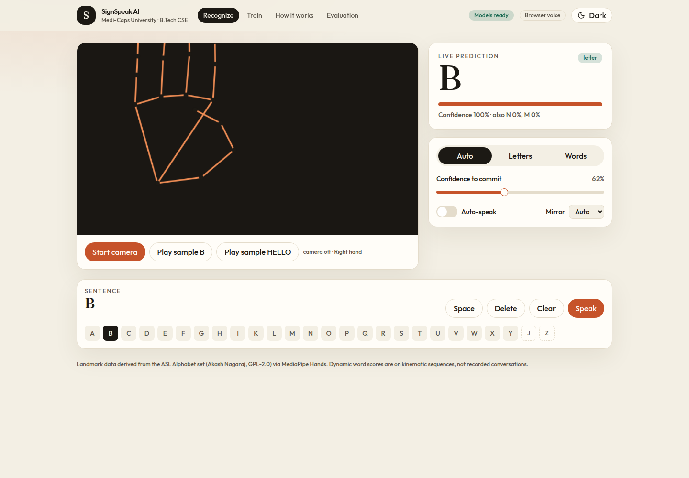
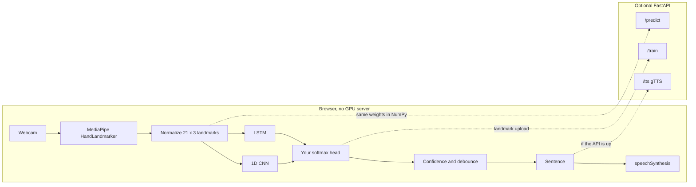

# SignSpeak AI

Built by Dhritika Sahu.

SignSpeak AI turns a hand in a webcam into letters, a short English sentence, and speech. The page runs in the browser: MediaPipe finds the hand, a TensorFlow.js CNN reads still ASL letters, geometric rules read a set of common words, and `speechSynthesis` speaks the sentence. A small Python API is optional. If it is down, the page still recognizes signs and still speaks.

[Run it locally](#run-the-app) on port **43123** after `npm run dev` in `frontend/`.




The Evaluation page shows the held-out numbers and both confusion matrices.


## What it recognizes

**Static ASL letters** (1D CNN on one frame): A B C D E F G H I K L M N O P Q R S T U V W X Y.

J and Z are motions, so they are not in the still-letter model.

**Words** (geometric rules on the landmarks): HELLO, YES, NO, THANKS, PLEASE, SORRY, ME, YOU, WE, LOVE, STOP, WATER, MORE, DRINK, EAT, GO, COME, GOOD, BAD, LIKE, WANT, NEED, WHERE, WHAT, NAME, FINE, HOME, plus the two-hand signs **HELP** (fist on an open palm) and **SCHOOL** (two flat hands clapping). These are simplified one-hand forms (except HELP/SCHOOL). Their scores come from a synthetic test, see below. A presentation button plays ME → WANT → WATER and speaks “I want water.” if the camera fails.

**ASL beta mode** (trained on real signers): a small network trained on the PopSign ASL dataset reads 14 real ASL word forms (BAD, DRINK, FINE, GO, HELLO, HOME, LIKE, NO, PLEASE, THANKS, WATER, WE, WHERE, YES). It scored **89.38%** on 1,431 clips from 8 signers it never saw in training. It is opt-in because it has no “no sign” class, so it reads one sign at a time between pauses.

An earlier LSTM on kinematic sequences scored 99.12% on its synthetic holdout. That model is not used in the live demo. Do not quote 99.12% as webcam word accuracy.

You can add your own pose or motion from the Train page. Those signs stay in this browser (IndexedDB) and can be exported.

## Architecture



| Piece | Where |
| --- | --- |
| Camera, overlay, sentence, theme | `frontend/src/pages/RecognizePage.tsx` |
| Landmark math, shared with Python | `frontend/src/lib/normalize.ts`, `signspeak/preprocess.py` |
| Debounce | `frontend/src/lib/stabilizer.ts` |
| CNN and LSTM in the browser | `frontend/src/lib/model.ts` |
| Custom signs | `frontend/src/pages/TrainPage.tsx`, IndexedDB in `frontend/src/lib/storage.ts` |
| Keras training | `train_static.py`, `train_dynamic.py` |
| Official metrics | `evaluate.py` → `evaluation/` and the Evaluation page |
| API | `backend/app/main.py` (`/health`, `/predict`, `/tts`, `/train`) |
| OpenCV demo | `python demo_webcam.py` |

## Features added for the final demo

- **Learn page** (`/learn`): pick any word or still letter, watch an animated reference hand, read how to make it, then sign it to the camera and get “Correct!” or “That looked like X. Try again.” with a running score. **Play example** runs the built-in example through the same recognizer, so the grading can be shown without a camera. A 5-sign **quiz** hides the figure (Show hint reveals it) and gives a final score.
- **Text to sign** on the Learn page: type a sentence; known words show their sign card, other words are fingerspelled letter by letter, each with Replay.
- **Two-hand HELP and SCHOOL**: MediaPipe now tracks two hands; both are drawn.
- **Hindi**: a Voice selector (English / हिन्दी). The gloss sequence is mapped to a Hindi sentence with a phrase table (ME WANT WATER → “मुझे पानी चाहिए।”). If the device has a hi-IN voice it speaks Hindi; otherwise it speaks the English line and says so.
- **Sentence tools**: Copy, Share (falls back to copy when the browser cannot share) and Download .txt (a dated transcript of spoken lines).
- **Accuracy help**: a “Tips for best accuracy” dialog, and live hints over the video: too dark, too far, too close, keep the hand inside the frame, no hand found.
- **Tests**: every button, select and input is driven by a Playwright test (27 tests, fake webcam) that runs in CI before each deploy.

## Real test-set numbers

From `python evaluate.py` on the held-out splits (seed 42). These are the figures on the Evaluation page. They are not rounded.

| Model | Test accuracy | Macro F1 | What the test is |
| --- | --- | --- | --- |
| Static 1D CNN | **94.19%** | **94.23%** | 3,600 landmark rows, 15% stratified holdout |
| Dynamic LSTM | **99.12%** | **99.13%** | 800 sequences whose source photographs were not in training |

Static depth check: adding Gaussian noise of σ = 0.1 on z changes accuracy to 94.22%, so the browser may pass real MediaPipe depth through (`z_mode: passthrough`).

The usual static confusions are M↔N, then P→Q and R→U. Those pairs look alike as 21 points.

The dynamic score is high because the motions are generated. See [Dynamic signs](#dynamic-signs) before treating 99% as a webcam result.

### Real signers: PopSign ASL word model

PopSign ASL v1.0 (Starner et al., NeurIPS 2023), **CC BY 4.0**, frames from `huggingface.co/datasets/sign/popsign-images`. Landmarks were extracted with MediaPipe (`training/extract_popsign.py`, `training/popsign_words.py`). Split by signer: 4,898 training clips from 31 signers, 1,431 test clips from 8 different signers.

| Model | Test accuracy | Macro F1 | Top-3 |
| --- | --- | --- | --- |
| MLP (256 hidden), 14 words | **89.38%** | **88.87%** | 94.83% |

The app's own TypeScript port with the shipped weights reproduces 89.4% on the same clips. The hand-written rules score only **9.8%** on those clips (no word at all on 58.1%), because the rules expect this app's simplified one-hand forms and PopSign signers use real ASL forms. That is why the trained model is offered as the separate ASL beta mode.

### Synthetic per-sign test (not real people)

A 3D hand model performs every sign 20 times with random hand side, size, position, rotation, speed, camera shape and jitter, and the samples go through the real recognizer. A sample passes only if exactly the right sign is added once. Results (`frontend/public/evaluation/synthetic_signs.json`):

- Words, Auto mode: **93.3%** overall. Weakest: LIKE 45%, DRINK 70%, EAT 80%, NEED 80%, COME 85%, HOME 85%.
- Letters, Letters mode: **92.3%**. Weakest: M 65%, N 75%, T 80%, V 85%, X 85%.
- Letters in Auto mode: 71%, because W, O, F and X are read as WATER, MORE, FINE and NEED. Use Letters mode to spell.
- HELP and SCHOOL: at least 80% each over 24 variations, with no two-hand false reads on one-hand words (`src/test/twohands.test.ts`).

These are a regression check on the rules, not a webcam study.

## Dataset and license

**Static letters.** 1,000 MediaPipe Hands rows for each of 24 letters, file `hand_dataset_1000_24.csv` from [MinorvaFalk/KNN_Alphabet](https://github.com/MinorvaFalk/KNN_Alphabet). Those rows were extracted from the [ASL Alphabet](https://www.kaggle.com/datasets/grassknoted/asl-alphabet) photographs by Akash Nagaraj (Kaggle, 2018), which is **GPL-2.0**. The photographs are one signer in even light, often augmented. A random split therefore shares that signer’s appearance between train and test. Live accuracy on a new hand will be lower until you record a few bursts on the Train page.

Columns are `class, x1, y1, … x21, y21`. There is no z in the file. The network still takes a 21×3 tensor; z is filled and lightly noised during training.

**Dynamic signs.** There is no small, freely downloadable ASL *word* set of MediaPipe landmarks that can be fetched without a Kaggle login. The LSTM is trained on kinematic sequences **seeded by real handshapes** from the letter file:

| Sign | Handshape donor | Motion |
| --- | --- | --- |
| J | I | J stroke |
| Z | D | Z stroke |
| HELLO | B | side-to-side wave |
| YES | S | nod |
| NO | V | wag (rotation) |
| THANKS | B | drift downward |
| PLEASE | B | circle |
| SORRY | A | smaller circle |

Train and test use different source photographs (220 vs 50 per class, with several random speeds and sizes). The number above is that held-out synthetic test. It is not a recording of people signing those words. The Train page is the supported way to add a motion the way *you* sign it.

The code and the weights derived from the GPL-2.0 photographs are released under GPL-2.0. See `LICENSE`.

## Run the app

### In VS Code

1. Install [Node.js 20 or newer](https://nodejs.org/) if `node -v` fails in a terminal.
2. Unzip `SignSpeak-AI.zip` and open that folder in VS Code (**File → Open Folder**). Do not open the zip itself.
3. Open a terminal in VS Code (**Terminal → New Terminal**) and run:

```bash
cd frontend
npm ci
npm run dev
```

4. VS Code will offer to open the local server. If it does not, go to http://127.0.0.1:43123 .
5. Allow the camera, or press **Play sample B** / **Play sample HELLO** if this computer has no webcam.

**Terminal → Run Task → SignSpeak: start dev server** runs the same two commands.

The browser app does not need Python. The optional API is below.

```bash
cd frontend
npm ci
npm run dev
```

Open http://127.0.0.1:43123 . Allow the camera, or press **Play sample B** / **Play sample HELLO** if you have no webcam. Those buttons feed recorded landmarks through the same normalizer, model, and sentence builder.

```bash
cd frontend
npm test          # Vitest: normalize, sentence, debounce, TF.js parity
npm run build     # writes ../dist
```

### API (optional)

```bash
python -m venv .venv && source .venv/bin/activate
pip install -r backend/requirements.txt
PYTHONPATH=. uvicorn backend.app.main:app --host 0.0.0.0 --port 8765
PYTHONPATH=. pytest
python demo_webcam.py --samples
```

On localhost the page probes `http://127.0.0.1:8765/health` and then `/api/health`. When the probe succeeds, **Speak** asks `POST /tts` for an mp3 and falls back to the browser voice if gTTS cannot reach Google. Set `VITE_API_URL` at build time to point a static deploy at a public API.

`python demo_webcam.py --camera 0` opens an OpenCV window. Without a camera, `--samples` classifies one landmark row per letter and writes `evaluation/opencv_demo.png`.

### Train the models again

```bash
pip install -r backend/requirements.txt
PYTHONPATH=. python train_static.py
PYTHONPATH=. python train_dynamic.py
PYTHONPATH=. python evaluate.py
```

`train_static.py` downloads the landmark CSV (SHA-256 pinned in `signspeak/data.py`) into `data/raw/`, which is gitignored. The checked-in weights are the result of that run.

## Deploy

No deploy token was available in this environment (no Vercel, Netlify, Cloudflare, or Hugging Face credential), so there is no public URL yet. The repo is set up so a static host and a free API host can be attached without code changes.

**Frontend, static.** `frontend` builds to `/dist`.

- GitHub Pages for `dhritika-Git-06/signspeak`: `.github/workflows/deploy-pages.yml` builds with `VITE_BASE=/signspeak/` and deploys `dist`. The site is then at `https://dhritika-git-06.github.io/signspeak/`. Local `npm run dev` leaves the base at `/`.
- Vercel: import the repo. `vercel.json` sets the install, build, output directory `dist`, and the SPA rewrite. Do not set `VITE_BASE` there.
- Netlify: `netlify.toml` publishes `dist`.
- Cloudflare Pages: build command `cd frontend && npm ci && npm run build`, output directory `dist`.

Do not put a secret in the frontend. If you deploy the API, rebuild with `VITE_API_URL=https://your-api.example`.

**API.**

- Render: `render.yaml` builds `backend/Dockerfile` (Python 3.11, NumPy inference, no TensorFlow in the image) and checks `/health`.
- Hugging Face Spaces: the repo-root `Dockerfile` listens on port **7860**, which Spaces expects. Create a Docker Space and point it at this repo.
- Both together: `docker compose up --build` serves the API on port 8765 and nginx on port 43123, with `/api` proxied to the API.

The serving image does not include TensorFlow. `evaluate.py` and the training scripts do.

## Pages

- **Recognize** — camera, landmark overlay (two hands), live framing hints, tips dialog, live letter, confidence, alphabet strip, sentence with optional Hindi line, space / delete / clear, speak (English or Hindi), copy / share / download, auto-speak, Auto / Letters / Words / ASL beta mode.
- **Learn** — reference figures, practice with grading and score, 5-sign quiz, text to sign.
- **Train** — name a sign, record bursts, fit a TF.js head, export and import JSON. If the API is up, the same samples are posted to `/train`.
- **How it works** — the pipeline in plain language, including what the project does not claim.
- **Evaluation** — measured accuracy, each number labelled *Real data* or *Synthetic test*: letter CNN, PopSign word model vs rules, per-sign synthetic tables, confusion matrices, dataset citations.

Light and dark follow the system theme until you toggle them. The choice is stored locally.

## Limitations

- Fingerspelling and a handful of isolated signs, not conversational ASL. No face, eyebrows, or body grammar.
- The word rules use simplified forms. On real ASL clips (PopSign) they score 9.8%; the ASL beta model scores 89.38% but covers only 14 words and needs a pause between signs.
- The synthetic per-sign scores are not a study with real webcam users.
- Hindi speech depends on the device having a Hindi voice (most Windows and Android devices do; some Linux browsers do not). The Hindi text is always shown.
- The public photograph set is a single signer. M and N, and a few other pairs, stay easy to confuse.
- J and Z are only on the motion model, and those motions are templates, not a filmed corpus.
- Auto mode switches on hand motion. A very still word or a shaky letter can pick the wrong network. The Letters / Words toggle overrides it.
- Custom signs are only as good as the bursts you record, and they live in that browser until you export them.
- gTTS needs the API and outbound network. The browser voice does not.
- The first visit downloads the hand landmarker (~8 MB) and the MediaPipe WASM (~14 MB).

## Future scope

These are the natural next steps for this project, in the same spirit as a final-year synopsis:

- Continuous signing, not one letter or one isolated word at a time.
- Indian Sign Language vocabulary beside the ASL alphabet.
- Non-manual signals: face and head.
- Speech-to-sign the other way, with an avatar.
- A multi-signer landmark set so the reported accuracy matches new hands.
- On-device speech that does not call Google, and a phone layout that is the primary UI rather than a responsive page.
- A grammar pass over the fingerspelled string before it is spoken.

`docs/REPORT.md` maps each required objective to the file that implements it.
